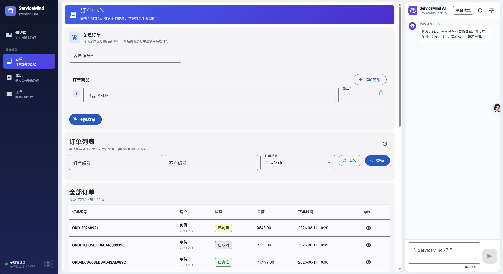
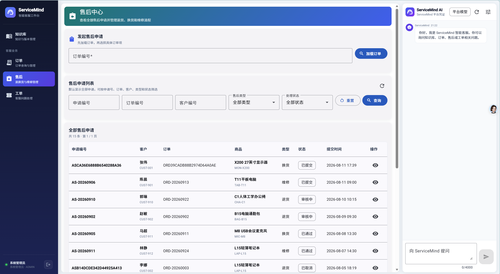
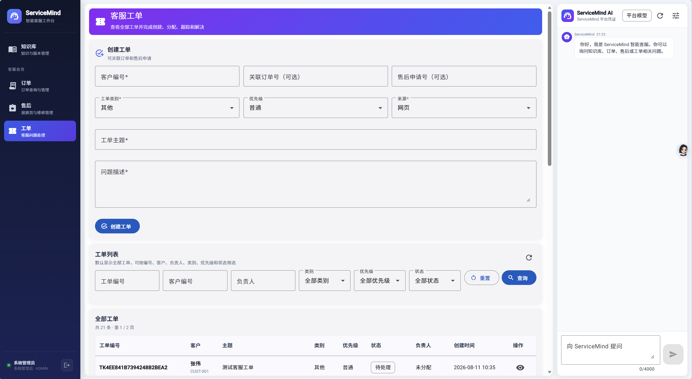
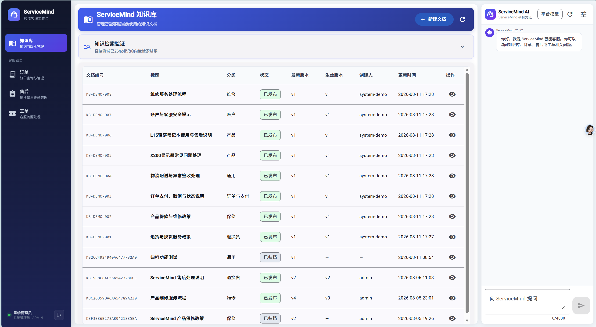
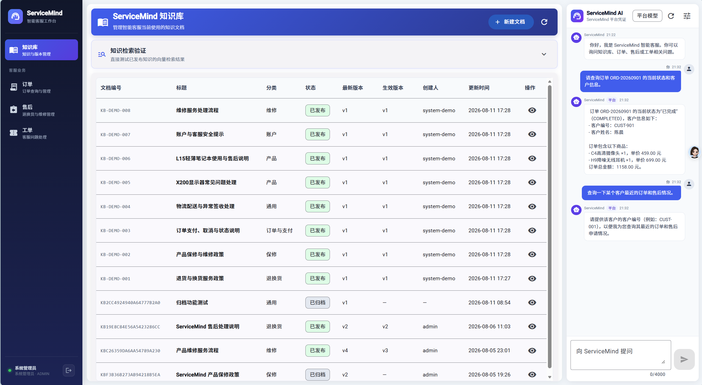

# ServiceMind

> 基于 Spring Boot、Angular、PostgreSQL、pgvector 与 Spring AI 构建的智能客服与售后服务平台。

ServiceMind 面向真实客服业务链路设计，不是单纯的 CRUD 示例。系统围绕“客户—订单—售后—工单—知识库—AI 客服”展开，集成会话认证、RBAC、知识库版本管理、向量检索、RAG、Spring AI Tool Calling、多轮对话以及可选 BYOK 模式。

## 项目亮点

- 完整客服业务链：客户 → 订单 → 售后申请 → 客服工单 → 知识检索 → AI 辅助
- Spring Security Session 登录认证，支持 `ADMIN` / `AGENT` 两级权限
- 订单状态流转与业务规则校验
- 售后申请审核、处理流程
- 客服工单分配、等待客户、解决等状态流转
- 知识文档版本管理、发布/归档、TXT/Markdown 上传
- PostgreSQL + pgvector 语义检索
- 基于知识库的 RAG 智能问答
- Spring AI Tool Calling 查询订单、售后、工单等业务数据
- 多轮客服会话
- 平台模型 + 临时 BYOK 模式
- 公网演示场景下的限流、额度、会话与异常信息安全控制
- Flyway 管理数据库结构与演示数据迁移
- 订单、售后、工单分页工作台与组合筛选

## 技术栈

### 后端
- Java 25
- Spring Boot 3.5.10
- Spring Security 6.5.x
- Spring AI 1.1.7
- Spring Data JPA
- Flyway
- Maven

### 前端
- Angular 21
- Angular Material
- TypeScript
- RxJS
- SCSS

### 数据与 AI
- PostgreSQL 16
- pgvector
- Qwen / DashScope 兼容模型
- `text-embedding-v4`
- RAG
- Spring AI Tool Calling

### 工程与部署
- Docker Compose
- Git / GitHub
- `application-prod.properties` 生产环境配置

## 系统架构

```text
┌──────────────────────┐
│      Angular 21      │
│  Material UI / SPA   │
└──────────┬───────────┘
           │ HTTP / JSON
           ▼
┌──────────────────────────────────────┐
│          Spring Boot Backend         │
│                                      │
│  Spring Security                     │
│  ├─ Session Authentication           │
│  └─ ADMIN / AGENT RBAC               │
│                                      │
│  Business Modules                    │
│  ├─ Customer / Product               │
│  ├─ Order                            │
│  ├─ After-sales                      │
│  ├─ Support Ticket                   │
│  └─ Knowledge Base                   │
│                                      │
│  AI Layer                            │
│  ├─ Spring AI                        │
│  ├─ RAG Retrieval                    │
│  ├─ Tool Calling                     │
│  ├─ Multi-turn Chat                  │
│  └─ Platform / BYOK Session          │
└──────────┬───────────────────────────┘
           │
           ▼
┌──────────────────────────────────────┐
│       PostgreSQL 16 + pgvector       │
│ Business Data / Knowledge / Vectors  │
└──────────────────────────────────────┘
```

## 核心业务流程

```text
客户
 │
 ▼
订单
 │
 ├─ CREATED → PAID → SHIPPED → COMPLETED
 │
 └─ CREATED / PAID → CANCELLED
 │
 ▼
售后申请
 │
 ▼
客服工单
 │
 ├─ 分配处理人
 ├─ 客户沟通
 └─ 完成解决
 │
 ▼
知识库检索 + AI 客服辅助
```

## 核心模块

### 1. 订单管理

订单工作台支持全量分页展示，并可按订单号、客户编号、状态等条件筛选。

后端限制非法状态跳转，当前订单生命周期为：

```text
CREATED → PAID → SHIPPED → COMPLETED
   └──────────────→ CANCELLED
PAID ─────────────→ CANCELLED
```

### 2. 售后服务

售后申请与真实订单、客户数据关联，支持列表筛选、分页查询、详情查看以及基于当前状态的审核和处理操作。

### 3. 客服工单

工单用于承接客服处理过程，包含工单分类、优先级、处理人分配、等待客户回复及完成解决等业务状态。

### 4. 知识库

知识库支持：

- 新建和编辑文档
- TXT / Markdown 上传
- 文档版本管理
- 发布与归档
- 文本切块
- Embedding 生成
- pgvector 向量存储
- 语义检索
- 仅检索当前已发布有效版本

### 5. AI 智能客服

AI 客服支持：

- 多轮会话
- 基于知识库的 RAG
- 只读业务 Tool Calling
- 查询订单、售后、工单等业务上下文
- 平台统一模型
- 用户临时 BYOK 模型会话

BYOK Key 仅用于短期会话，不写入 Git，也不作为长期数据库字段保存。

## 认证与权限

ServiceMind 使用服务端 Session，而不是在浏览器中保存 JWT。

```text
Angular
  │
  ├─ POST /api/auth/login
  ▼
Spring Security
  │
  ├─ DB AppUser
  ├─ BCrypt
  └─ HttpSession Cookie
```

权限划分：

| 角色 | 权限 |
|---|---|
| `AGENT` | 查看业务数据、处理售后/工单、使用 AI/BYOK、读取和检索知识库 |
| `ADMIN` | 拥有 AGENT 权限，并可执行订单写操作和知识库管理操作 |

生产配置额外启用安全 Cookie，并隐藏详细异常信息。

## 公网 Demo 安全设计

项目针对公开简历 Demo 增加了：

- 平台模型用户级请求限流
- 平台模型全局每日额度
- BYOK 请求限流
- BYOK Session 创建频率限制
- 单用户最大活跃 BYOK Session 数量
- BYOK Session 与当前登录用户绑定
- BYOK Key 仅短期保存在内存
- 文件上传大小限制
- 统一 API 错误响应
- 生产环境隐藏异常堆栈与绑定细节
- Actuator 仅暴露必要健康检查接口

当前限流器采用单实例内存实现，定位为公开演示环境，而非分布式生产限流方案。

## 演示数据

Flyway `V8__expand_demo_data.sql` 提供完整联动演示数据，覆盖：

- 客户
- 产品
- 订单
- 订单项
- 售后申请
- 客服工单
- 知识文档

模拟数据覆盖多种状态，可直接用于分页筛选、业务流程演示和 AI Tool Calling，无需每次手工造数。

## 本地运行

### 环境要求

- Java 25+
- Node.js 24+
- npm
- Docker Desktop / Docker Compose
- PostgreSQL + pgvector
- 使用平台 AI 功能时需要 DashScope API Key

### 1. 克隆项目

```bash
git clone https://github.com/zhangnianshuai/ServiceMind.git
cd ServiceMind
```

### 2. 配置环境变量

真实密钥不要提交到 Git。

例如：

```text
DB_PASSWORD=your_database_password
DASHSCOPE_API_KEY=your_dashscope_key
```

管理员和客服演示账号密码同样通过项目已有的环境变量机制配置。

### 3. 启动数据库

```bash
docker compose up -d
```

### 4. 启动后端

Windows PowerShell：

```powershell
.\mvnw spring-boot:run
```

Linux / macOS：

```bash
./mvnw spring-boot:run
```

默认地址：

```text
http://localhost:8080
```

### 5. 启动前端

```bash
cd frontend
npm install
npm start
```

默认地址：

```text
http://localhost:4200
```

## 测试

后端测试：

```bash
./mvnw test
```

当前测试覆盖认证 Session 流程、权限策略、知识上传、检索、Retrieval Service 及相关领域逻辑。

前端构建：

```bash
cd frontend
npm run build
```

## 主要 API

```text
/api/auth/**
/api/orders/**
/api/after-sales/**
/api/tickets/**
/api/knowledge/**
/api/customer-support
/api/model-sessions/**
```

本地开发时 Angular 通过代理访问后端 API。

## 项目结构

```text
ServiceMind/
├─ frontend/
│  └─ src/app/
│     ├─ components/
│     ├─ directives/
│     ├─ guards/
│     ├─ interceptors/
│     ├─ services/
│     └─ types/
├─ src/main/java/.../servicemind/
│  ├─ api/
│  ├─ application/
│  ├─ bootstrap/
│  ├─ domain/
│  ├─ security/
│  └─ service/
├─ src/main/resources/
│  ├─ db/migration/
│  ├─ application.properties
│  └─ application-prod.properties
├─ compose.yaml
├─ pom.xml
└─ README.md
```

<!-- servicemind-showcase:start -->
## 系统界面

### 订单工作台

支持订单全量分页、订单号/客户/状态筛选，以及受业务规则约束的订单状态流转。

<p align="center">
  
</p>

### 售后服务

售后申请与订单、客户信息关联，支持多条件检索、详情查看及基于当前状态的审核与处理流程。

<p align="center">
  
</p>

### 客服工单

工单工作台展示优先级、分类、负责人及处理状态，并支持分配、等待客户、恢复处理和解决等流程。

<p align="center">
  
</p>

### 知识库管理

知识库支持文档管理、版本控制、发布/归档、文件上传、向量化与语义检索。

<p align="center">
  
</p>

### AI 智能客服

AI 客服结合多轮会话、知识库 RAG 与 Spring AI Tool Calling，在回答知识问题的同时可读取订单、售后、工单等业务上下文。

<p align="center">
  
</p>
<!-- servicemind-showcase:end -->

## 当前进度

- [x] 客户 / 产品 / 订单领域
- [x] 订单生命周期
- [x] 售后流程
- [x] 客服工单流程
- [x] 知识库版本管理与向量检索
- [x] RAG 智能客服
- [x] Spring AI Tool Calling
- [x] 多轮聊天
- [x] 平台模型 + BYOK
- [x] Session 登录认证与 RBAC
- [x] 公网 Demo 安全加固
- [x] 扩充演示数据库
- [ ] 腾讯云部署
- [ ] 公网演示地址
- [ ] 架构图 / ER 图
- [ ] 最终 UI 截图
- [ ] 演示账号说明

## 在线演示


- **ServiceMind 在线 Demo**：http://124.221.202.140/
- **部署环境**：Tencent Cloud + Docker Compose + Nginx

## 项目说明

ServiceMind 基于早期 Spring AI 示例工程进行二次开发，但当前代码已围绕智能客服业务进行了较大规模重构与扩展，包括业务领域、工作流、知识库、向量检索、认证授权、AI 会话管理、BYOK、公网演示安全控制以及 Angular 管理工作台等。

## License

当前暂未指定 License。
