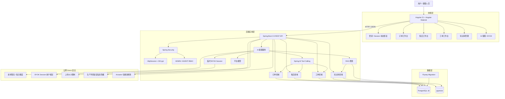

# ServiceMind 系统架构

## 说明

- 前端采用 Angular SPA，通过后端 REST API 完成业务操作。
- Spring Security 使用服务端 Session 认证，不在浏览器本地持久化 JWT。
- ADMIN 与 AGENT 采用 RBAC 权限控制。
- 订单、售后、工单、知识库构成核心业务域。
- AI 客服同时使用知识库 RAG 与只读业务 Tool Calling。
- 平台模型与 BYOK 模式共存，BYOK Key 仅用于短期会话。
- PostgreSQL 保存业务数据，pgvector 保存知识向量。
- Flyway 统一管理数据库结构和演示数据迁移。
