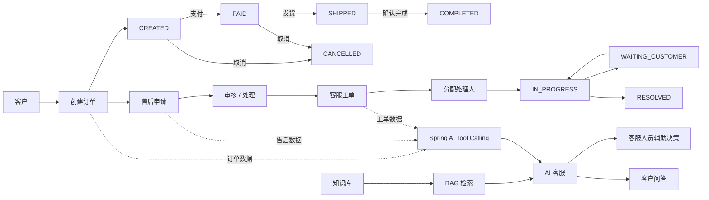

# ServiceMind 核心业务流程

## 业务链路

1. 客户产生订单，订单按照受控状态机流转。
2. 订单产生问题后可进入售后申请流程。
3. 售后问题进一步进入客服工单处理。
4. 工单支持分配、处理中、等待客户和解决等状态。
5. AI 客服通过知识库 RAG 获取政策与说明类知识。
6. AI 客服通过只读 Tool Calling 查询订单、售后和工单数据。
7. 最终为客服人员或客户提供带业务上下文的回答。
